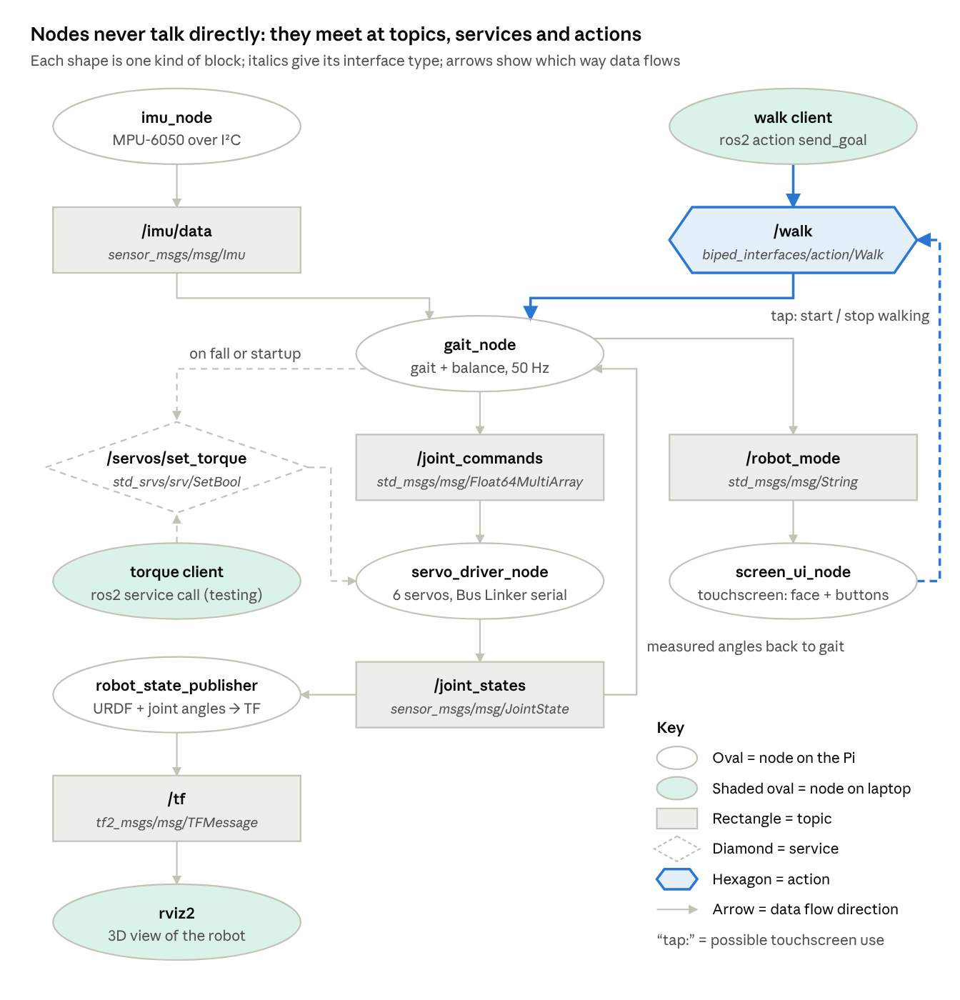
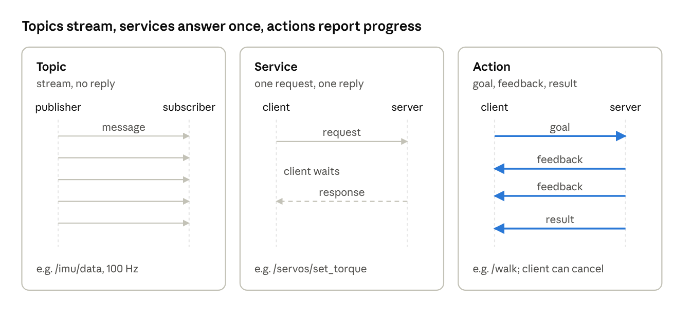
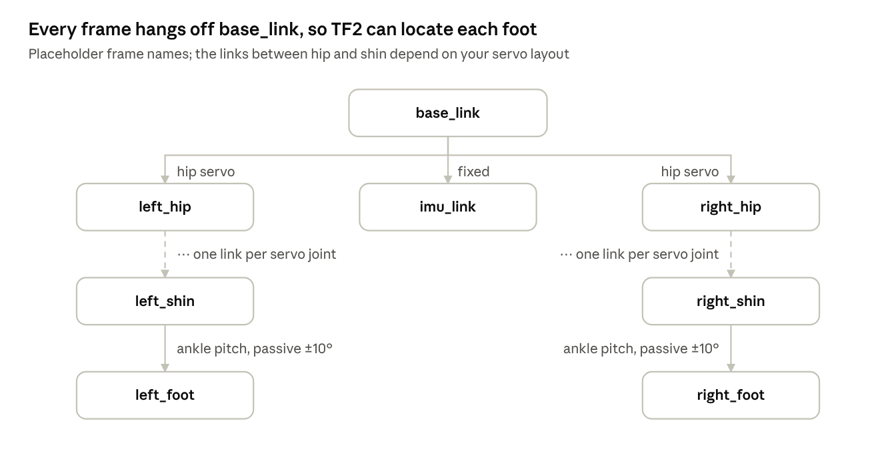
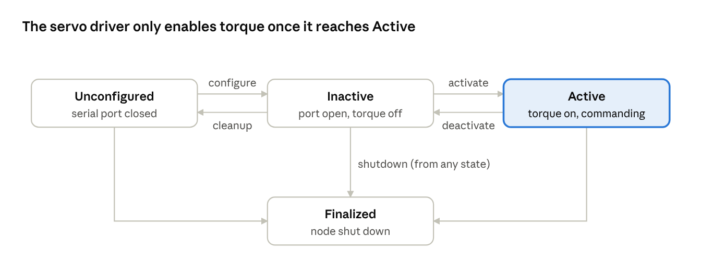

# ROS 2 Concepts for the Bipedal Robot

Nov 12, 2026

These are the ROS 2 pieces a small bipedal robot actually uses. Each entry says what it is, why it matters, and how it would be used on this robot, plus the basic `ros2` CLI commands where the CLI is the simple way in.

**Hardware assumed in the examples:** Raspberry Pi 4B, bus servos driven through the Bus Linker (serial), a GY-521 (MPU-6050) IMU on I²C, and the 5" DSI screen.

**Commands assume** ROS 2 Jazzy (the LTS release for Ubuntu 24.04, which runs on the Pi 4). Most also work on Humble. Names in angle brackets or under `biped_*` are placeholders for your own packages and nodes. Before any command will find your code, source the workspace with `source ~/biped_ws/install/setup.bash`.

## Core building blocks

Nodes talking over topics, services and actions are the skeleton of every ROS 2 robot. Everything else in this doc builds on them.



Solid arrows are topics, the dashed two-way arrow is a service, and the highlighted line is an action. The node and topic names are the examples used throughout this doc; `rqt_graph` draws the live version of this picture for your real system.

### Nodes

**What:** A node is a single program (a process) that does one job.

**Why:** You can write, test, restart and swap each job on its own. A crash in one node doesn't take down the robot.

**Example:** `imu_node` reads the MPU-6050 over I²C. `servo_driver_node` talks to the Bus Linker over serial. `gait_node` generates walking motions, and `face_node` draws on the screen.

```bash
ros2 run biped_hardware imu_node      # start a node: ros2 run <package> <executable>
ros2 node list                        # see every running node
ros2 node info /imu_node              # its publishers, subscribers, services, actions
```

### Topics

**What:** A topic is a named channel for a continuous stream of data, such as `/imu/data` or `/joint_states`.

**Why:** Nodes don't need to know about each other. They only need to agree on a topic name and a message type.

**Example:** The IMU node streams orientation and acceleration on `/imu/data` about 100 times a second.

```bash
ros2 topic list -t                    # all topics, with their message types
ros2 topic echo /imu/data             # print messages as they arrive
ros2 topic hz /imu/data               # measure the publish rate
ros2 topic info /imu/data -v          # who publishes and subscribes, and their QoS
```

### Publishers / Subscribers

**What:** A publisher sends messages on a topic, and a subscriber receives them. A topic can have many of each.

**Why:** This is the main "many-to-many, fire-and-forget" way nodes communicate. It suits sensor data and commands sent over and over.

**Example:** `imu_node` publishes `/imu/data`, and the balance controller and a logger both subscribe to it. The gait node publishes target joint angles, and the servo driver subscribes and sends them to the servos.

Publishers and subscribers are written in code (`create_publisher` / `create_subscription` in rclpy). The CLI can stand in for either end while testing:

```bash
# act as a publisher: send one command by hand
ros2 topic pub --once /joint_commands std_msgs/msg/Float64MultiArray "{data: [0.0, 0.2, -0.4, 0.2]}"
# publish repeatedly at 10 Hz (Ctrl+C to stop)
ros2 topic pub --rate 10 /joint_commands std_msgs/msg/Float64MultiArray "{data: [0.0, 0.2, -0.4, 0.2]}"
# act as a subscriber: ros2 topic echo (above)
```

### Interfaces (messages, services, actions)

**What:** Interfaces define the data structures nodes exchange: `.msg` for topics, `.srv` for request/response, and `.action` for long-running goals.

**Why:** They're strongly typed, so every node agrees on the format. Use the standard ones (`sensor_msgs/Imu`, `sensor_msgs/JointState`, `std_srvs/SetBool`) wherever you can, because tools like RViz already understand them.

**Example:** `sensor_msgs/JointState` for servo positions. A custom `ServoStatus.msg` for voltage, temperature and load, since the bus servos report those.

```bash
ros2 interface show sensor_msgs/msg/Imu     # fields of a type
ros2 interface list                          # every type installed
ros2 interface package std_srvs              # types in one package
ros2 interface proto sensor_msgs/msg/JointState   # a fill-in-the-blanks template for ros2 topic pub
```

Custom interfaces aren't made from the CLI. Put them in their own CMake package (`ros2 pkg create --build-type ament_cmake biped_interfaces`), add files like `msg/ServoStatus.msg`, and list them in `rosidl_generate_interfaces(...)` in that package's `CMakeLists.txt`.

### Services

**What:** A service is a request → response call, like a function call between nodes. It's one-off and the caller waits for the answer.

**Why:** It's good for quick commands that need a confirmation, and wasteful for streaming data.

**Example:** `/servos/set_torque` turns servo torque on or off (to go limp safely). `/imu/calibrate` zeros the gyro while the robot stands still.

```bash
ros2 service list -t                          # services and their types
ros2 service type /servos/set_torque
ros2 service call /servos/set_torque std_srvs/srv/SetBool "{data: false}"   # go limp
```

### Actions

**What:** An action is a long-running goal. While it runs, the action server sends feedback, and the client can cancel it.

**Why:** Some tasks take seconds. You want progress updates and the ability to stop partway, which topics and services don't give you.

**Example:** A `/walk` action with the goal "take 10 steps." It sends feedback ("step 4 of 10") and is cancelled if the IMU detects a fall. `/stand_up` and `/sit_down` fit the same pattern.

```bash
ros2 action list -t
ros2 action info /walk                        # its server and clients
ros2 action send_goal /walk biped_interfaces/action/Walk "{steps: 10}" --feedback
# Ctrl+C while a goal is running cancels it
```



Time runs downward. A service caller waits for its one reply, while an action client keeps receiving feedback until the result arrives, and can cancel along the way.

### Parameters

**What:** Parameters are configuration values that belong to a node. You can load them from a YAML file at startup and change them while the node runs.

**Why:** You can tune the robot without recompiling, which matters a lot for gaits.

**Example:** Step height, step length, cycle time, PID gains, the servo port (`/dev/ttyUSB0`) and per-servo calibration offsets, all in `gait_params.yaml`.

```bash
ros2 param list /gait_node
ros2 param get /gait_node step_height
ros2 param set /gait_node step_height 0.02          # change it live
ros2 param dump /gait_node > gait_params.yaml       # save the current values to a file
ros2 run biped_control gait_node --ros-args --params-file gait_params.yaml
ros2 run biped_control gait_node --ros-args -p step_height:=0.02   # set one at launch
```

### Timers, callbacks and executors

**What:** A node's work runs in callbacks, which fire when a message arrives or a timer ticks. The executor decides when those callbacks run.

**Why:** This is how you get a steady control loop instead of a `while True` loop that blocks everything else.

**Example:** A 50 Hz timer in `gait_node` computes the next joint positions and publishes them on each tick.

These are set up in code (`create_timer(0.02, self.step)`), not from the CLI. To check the loop really runs at 50 Hz, use `ros2 topic hz /joint_commands`.

### QoS (Quality of Service)

**What:** QoS settings control delivery: reliable vs. best-effort, how many old messages to keep, and whether a late subscriber gets the last message.

**Why:** For fast sensor data the newest value matters more than guaranteed delivery. For one-time configuration you want guaranteed delivery.

**Example:** `/imu/data` uses best-effort with depth 1, so the balance loop never works on stale readings. A `/robot_mode` topic uses reliable delivery.

```bash
ros2 topic info /imu/data -v                       # shows each endpoint's QoS
ros2 topic echo /imu/data --qos-profile sensor_data   # match a best-effort publisher
```

If `echo` prints nothing on a topic you know is publishing, the cause is usually a QoS mismatch (a reliable subscriber on a best-effort publisher).

## Organizing and running code

Your code lives in packages inside a workspace, gets built with colcon, and runs from launch files.

### Packages

**What:** A package is the unit of ROS code: a folder with a `package.xml` (metadata and dependencies) plus Python (`ament_python`) or C++ (`ament_cmake`) code.

**Why:** Packages keep the project modular and let the build system resolve dependencies.

**Example:** A sensible split for this robot:

- `biped_description`: URDF and meshes
- `biped_hardware`: servo and IMU drivers
- `biped_control`: gait and balance
- `biped_interfaces`: custom messages, services and actions (must be a CMake package)
- `biped_bringup`: launch files and parameter YAMLs

```bash
cd ~/biped_ws/src
ros2 pkg create --build-type ament_python --dependencies rclpy sensor_msgs \
    --node-name imu_node biped_hardware        # new Python package with a starter node
ros2 pkg list                                   # installed packages
ros2 pkg executables biped_hardware             # runnable nodes in a package
ros2 pkg prefix biped_hardware                  # where it's installed
```

### Workspace and colcon

**What:** The workspace (`~/biped_ws/src/...`) holds your packages. `colcon build` compiles all of them, and sourcing `install/setup.bash` makes them available in your terminal.

**Why:** It's the standard build-and-run workflow.

**Example:** After editing the gait node, rebuild only that package and relaunch.

```bash
mkdir -p ~/biped_ws/src && cd ~/biped_ws
rosdep install --from-paths src --ignore-src -y     # install dependencies listed in package.xml files
colcon build --symlink-install                      # build all (Python edits apply without rebuilding)
colcon build --packages-select biped_control        # build one package
source install/setup.bash                           # needed in every new terminal
```

Add the `source` line to `~/.bashrc` on the Pi so you don't forget it.

### Launch files

**What:** A launch file is a Python (or XML/YAML) script that starts many nodes at once, with their parameters and remappings.

**Why:** You don't want to open seven terminals every time you turn the robot on.

**Example:** `robot.launch.py` starts the IMU, servo driver, robot_state_publisher, gait and face nodes, loading `gait_params.yaml`. A second `sim.launch.py` starts the simulated version instead.

```bash
ros2 launch biped_bringup robot.launch.py
ros2 launch biped_bringup robot.launch.py --show-args     # list the arguments it accepts
ros2 launch biped_bringup robot.launch.py use_sim:=true   # pass an argument
```

Launch files themselves are written in a text editor and placed in the package's `launch/` folder (and installed through `setup.py` or `CMakeLists.txt`).

### Remapping and namespaces

**What:** These rename a node's topics, or group them under a prefix, when the node starts.

**Why:** You can reuse one node for several similar things without editing its code.

**Example:** Run the same leg-controller node twice, once as `/left_leg` and once as `/right_leg`.

```bash
ros2 run biped_control leg_controller --ros-args -r __ns:=/left_leg
ros2 run biped_control leg_controller --ros-args -r __ns:=/right_leg
# rename one topic, or the node itself
ros2 run biped_hardware imu_node --ros-args -r imu/data:=/body/imu -r __node:=body_imu
```

## Robot model and geometry

The URDF is the bridge from the SolidWorks assembly to ROS. Visualization, kinematics, simulation and ros2_control all read it.

### URDF / Xacro

**What:** A URDF is an XML description of the robot: links (rigid parts), joints (axes and limits), masses, inertias and meshes. Xacro adds macros and variables on top.

**Why:** Almost everything else in ROS uses it.

**Example:** Export it from the SolidWorks assembly with the community `sw_urdf_exporter` add-in. It officially targets older SolidWorks versions, so check it with yours. It pulls masses and inertias from your material settings. Because the legs mirror each other, Xacro lets you define one leg and instantiate it for left and right. The passive ankle becomes a revolute joint with ±10° limits.

```bash
xacro biped.urdf.xacro > biped.urdf        # expand xacro into plain URDF
check_urdf biped.urdf                      # parse it and print the link tree (liburdfdom-tools)
ros2 launch urdf_tutorial display.launch.py model:=$PWD/biped.urdf   # quick look in RViz with sliders
```

### TF2 (transforms)

**What:** TF2 tracks the coordinate frames (`base_link`, `left_foot`, `imu_link`...) and how they relate to each other over time.

**Why:** It answers "where is the left foot relative to the body right now?", which gait and balance math needs constantly.

**Example:** Look up `left_foot` relative to `base_link` to check the center of mass is over the support foot. The IMU's position in the floor tray gives the fixed `base_link` → `imu_link` transform.



`tf2_echo base_link left_foot` walks this tree for you, combining every joint angle along the left leg into one transform.

```bash
ros2 run tf2_ros tf2_echo base_link left_foot      # print one transform live
ros2 run tf2_tools view_frames                     # write frames.pdf showing the whole tree
# publish a fixed transform by hand (metres, radians)
ros2 run tf2_ros static_transform_publisher --x 0 --y 0.03 --z -0.06 \
    --frame-id base_link --child-frame-id imu_link
```

The `imu_link` numbers above are placeholders. Measure them from the IMU pocket's position relative to wherever you put `base_link`.

### robot_state_publisher / joint_state_publisher

**What:** `robot_state_publisher` reads the URDF and `/joint_states` and publishes every TF frame. `joint_state_publisher_gui` gives you sliders that fake joint states.

**Why:** Together they turn servo angles into a full 3D pose of the robot.

**Example:** Before any hardware is wired, drag the sliders to confirm the SolidWorks export moves correctly: joint axes point the right way and the limits are right.

```bash
ros2 run robot_state_publisher robot_state_publisher \
    --ros-args -p robot_description:="$(xacro biped.urdf.xacro)"
ros2 run joint_state_publisher_gui joint_state_publisher_gui
rviz2                                   # add RobotModel and TF displays, Fixed Frame = base_link
```

## Control

ros2_control is the standard way to connect controllers to motors. A plain custom driver node is also fine for a class project.

### ros2_control

**What:** A framework that separates the **hardware interface** (how to read and write your specific servos) from **controllers** (reusable logic such as `joint_trajectory_controller`).

**Why:** You write the Bus Linker driver once as a hardware plugin. The same controllers then run on both the real robot and the simulator.

**Example:** A `BusServoSystem` hardware plugin (C++) reads positions from the serial bus and writes position commands. A `joint_trajectory_controller` plays gait trajectories through it, and `joint_state_broadcaster` publishes `/joint_states`.

```bash
ros2 control list_hardware_interfaces          # what the hardware plugin exposes
ros2 control list_controllers                  # loaded controllers and their state
ros2 run controller_manager spawner joint_state_broadcaster      # load + start a controller
ros2 run controller_manager spawner joint_trajectory_controller
ros2 control switch_controllers --deactivate joint_trajectory_controller   # stop sending commands
```

The simpler alternative: a Python `servo_driver_node` that subscribes to `/joint_commands`, writes to the servos, and publishes `/joint_states`. ros2_control mainly pays off if you also simulate the robot.

### Lifecycle (managed) nodes

**What:** A lifecycle node moves through explicit states: unconfigured → inactive → active (and back).

**Why:** You get controlled startup and shutdown.

**Example:** The servo driver only enables torque once it's activated, after the IMU node reports it's ready. That keeps the robot from twitching on power-up.



Each arrow is one `ros2 lifecycle set` command. Deactivating drops back to Inactive, so the robot goes limp without the node exiting.

```bash
ros2 lifecycle nodes                           # which nodes are managed
ros2 lifecycle get /servo_driver               # current state
ros2 lifecycle set /servo_driver configure     # open the serial port, load offsets
ros2 lifecycle set /servo_driver activate      # enable torque, start commanding
ros2 lifecycle set /servo_driver deactivate    # go limp without killing the node
```

## Tools: debugging, testing and data

These tools show what the robot is doing and let you replay it afterwards. Run the heavy ones (RViz, Gazebo, plotting) on your laptop, not the Pi.

### Bag files (rosbag2)

**What:** `ros2 bag record` saves topic data to disk with timestamps. `ros2 bag play` replays it as if it were live.

**Why:** Walking tests are short and usually end in a fall. A recording lets you analyze it afterwards and test new code against old data.

**Example:** Record IMU, joint states and commands on every walk attempt. Afterwards, plot IMU pitch over time to see exactly when it started tipping, or replay the bag into a new balance node.

```bash
ros2 bag record -o walk_test_01 /imu/data /joint_states /joint_commands
ros2 bag record -a -o everything          # every topic (large files)
ros2 bag info walk_test_01                # duration, topics, message counts
ros2 bag play walk_test_01                # replay at real speed
ros2 bag play walk_test_01 --rate 0.25 --loop   # quarter speed, repeating
```

### RViz2

**What:** A 3D visualizer for robot models, TF frames, IMU orientation and markers.

**Why:** You see what the robot thinks is happening.

**Example:** Show the URDF moving live with the real servos, an arrow for IMU orientation, and a marker for the estimated center of mass.

```bash
rviz2                                    # set up displays, then File > Save Config
rviz2 -d ~/biped_ws/src/biped_bringup/config/biped.rviz   # reopen a saved layout
```

### Gazebo (simulation)

**What:** A physics simulator that loads your URDF. Jazzy pairs with Gazebo Harmonic.

**Why:** You can test gaits without breaking parts or draining batteries. Accurate masses and inertias from SolidWorks make it much more realistic.

**Example:** Tune step timing in simulation first, then move the same parameters to the real robot.

```bash
ros2 launch ros_gz_sim gz_sim.launch.py gz_args:=empty.sdf        # start an empty world
ros2 run ros_gz_sim create -topic robot_description -name biped   # spawn the robot (needs robot_state_publisher running)
```

Sensors and controllers inside Gazebo connect to ROS through `ros_gz_bridge` and `gz_ros2_control`. Those are set up in launch files rather than typed by hand.

### CLI introspection and rqt

**What:** The `ros2` CLI (used throughout this doc) plus GUI tools: `rqt_graph` (node and topic map), `rqt_plot` and PlotJuggler (live plots), and `rqt_console` (log messages).

**Why:** They're how you find out why something isn't working.

**Example:** `ros2 topic hz /imu/data` confirms the IMU really runs at 100 Hz. `rqt_graph` shows whether the gait node is actually connected to the servo driver.

```bash
rqt_graph                                # who talks to whom
ros2 run rqt_plot rqt_plot /imu/data/linear_acceleration/x
ros2 run plotjuggler plotjuggler         # better plots; also opens bag files
ros2 run rqt_console rqt_console         # filter log messages by node and severity
ros2 doctor --report                     # check the install and network setup
```

## Networking

### DDS and ROS_DOMAIN_ID

**What:** DDS is the middleware underneath ROS 2. It lets nodes find each other automatically across machines on the same network. `ROS_DOMAIN_ID` (0–101 is the safe range) isolates groups of robots on a shared network.

**Why:** You can run RViz, Gazebo and PlotJuggler on your laptop while the Pi runs the robot nodes, with no extra code.

**Example:** Give the robot a unique domain ID, so you don't see a classmate's robot on the school Wi-Fi (or command it by accident).

```bash
export ROS_DOMAIN_ID=42        # same number on the Pi and the laptop; add to ~/.bashrc on both
ros2 multicast receive         # run on one machine...
ros2 multicast send            # ...and this on the other, to test discovery
ros2 daemon stop               # clear stale node/topic lists after changing network settings
export ROS_AUTOMATIC_DISCOVERY_RANGE=LOCALHOST   # Jazzy: keep traffic on this machine only
```

If the Pi and laptop can ping each other but can't see each other's topics, check that both use the same domain ID, and that the network allows multicast. Some campus Wi-Fi networks block it.

## Design rules of thumb

The sections above say what each piece is. This one covers how to decide between them when you design your own system.

### What becomes its own node

The main rule: **one node per shared bus or device.** What decides it is what's shared, not how many devices there are: six servos on one serial bus are one resource, so they get one node. Inside that rule, split by rate, by swappability and by failure isolation.

**Make it a separate node when:**

- **It owns a separate device or bus.** The IMU (I²C) and the servos (serial) get separate nodes, so a hung I²C read can't stall servo commands.
- **It runs at a different rate.** IMU at 100 Hz, gait at 50 Hz, screen at about 10 Hz. Separate nodes let each run at its own pace.
- **You'd want to swap or reuse it.** With the servo driver separate, you can replace it with a simulator or a bag replay and the gait node never knows.
- **You want to restart or debug it alone.** Relaunch the gait node 50 times while tuning and leave the drivers running.
- **A crash shouldn't take everything down.** If `face_node` crashes, the robot should keep standing.

**Keep it in one node when:**

- **The parts share one resource**, like the servo bus.
- **They run in lockstep on tightly shared state**, such as gait generation and balance correction adjusting the same joint targets each cycle. Splitting them adds latency and jitter between two halves of one calculation.
- **They'd exchange lots of data at high rates** for no benefit. Every topic hop costs time and CPU, which matters on a Pi.

Inside one node you can still organize the code into separate classes (for example a `BusServo` class for the protocol and a node class for ROS). That gives clean code without extra processes.

**Worked example: why servo reads and writes stay in one node.** The 6 HTD-35H servos share one half-duplex serial bus at 115200 baud, reached through the Bus Linker's single USB port. The second Bus Linker port is the same bus, so it adds no bandwidth.

- **Only one process can safely open the serial port.** With two nodes, one fails to open it, or both succeed and their bytes interleave.
- **Half-duplex means taking turns.** A read is a request plus a reply. If a writer sends a move command mid-reply, packets collide. One node can run a fixed schedule, like "write all 6, then read 2."
- **Both use the same state.** Calibration offsets, IDs, limits and torque status live in one place.

From outside, the node still looks split: it subscribes to `/joint_commands`, publishes `/joint_states` and offers `/servos/set_torque`.

**Why not one node per servo?** It looks more robust, but it isn't:

- **Six nodes can't share one port.** They'd hit the same port-ownership and collision problems as splitting reads and writes, six times over. Taking turns would need a seventh node, which is just the servo driver again.
- **A biped can't walk on 5 of 6 joints.** When a servo fails, the right response is to stop safely, not to keep the others running.
- **Hardware faults usually hit several servos.** Each leg's 3 servos are daisy-chained, so a loose plug, power sag or shorted cable takes out the whole chain whatever the node layout.
- **Separate processes guard against software crashes, not hardware faults.** Six copies of the same driver share the same bugs.
- **Timing gets worse.** Six nodes on their own timers command the joints slightly out of step, adding jitter between legs that must move together.

Put the robustness inside the one driver instead: give each servo read a short timeout so one silent servo doesn't stall the others, track each servo's health in `ServoStatus`, and go to a safe state (torque off, lifecycle Inactive) when one stops responding.

One node per device *would* fit if each servo had its own connection, such as its own serial port or PWM pin with nothing shared.

| Node | Why it's separate |
| --- | --- |
| `servo_driver_node` | Sole owner of the serial bus; does all reads and writes |
| `imu_node` | Different bus (I²C) and rate (100 Hz) |
| `gait_node` | Your logic; swappable, restarted constantly while tuning. Holds balance too until that grows big enough to test alone |
| `face_node` | Slow and non-critical; its crash shouldn't matter |
| `robot_state_publisher` | Standard ROS node; no reason to rewrite it |

If you later want separate nodes without separate processes, ROS 2 **component containers** run several nodes in one process.

### Topic, service or action?

| If the communication is... | Use | Robot example |
| --- | --- | --- |
| Continuous data, or a command sent over and over | Topic | `/imu/data`, `/joint_commands` |
| A quick one-off command that needs a yes/no answer | Service | `/servos/set_torque` |
| A task that takes seconds and needs progress or cancelling | Action | `/walk`, `/stand_up` |

- **Don't use a service for streaming data.** Calling it 50 times a second adds a round trip each time and blocks the caller.
- **Keep service handlers fast**, well under a second. Anything longer should be an action.
- **In Python, call services asynchronously** (`call_async`) from inside a callback. A blocking `call` from a callback can deadlock the node.

### Topic design

- **Use a standard message type when one fits.** RViz, PlotJuggler and other people's code already understand `sensor_msgs/msg/Imu` and `sensor_msgs/msg/JointState`.
- **Use SI units everywhere:** metres, radians, seconds. The HTD-35H speaks 0–1000 for 0–240°; convert at the servo driver and nowhere else, so the rest of the system only sees radians.
- **Fill in the header.** Set `header.stamp` (when the data was measured) and `header.frame_id` (e.g. `imu_link`) so TF and bag replay can use it.
- **One meaning per topic.** Don't send "walk speed" and "mode" on the same topic; give each its own.
- **Write topic names without a leading slash in code** (`imu/data`, not `/imu/data`), so namespaces and remapping work. Use lowercase snake_case.
- **Decide what happens when commands stop.** If `/joint_commands` goes quiet (a crashed gait node, a dropped Wi-Fi link), the servo driver should notice after a timeout and hold position or go limp.

### Choosing QoS

| Data | QoS | Why |
| --- | --- | --- |
| Sensor streams (`/imu/data`) | Best effort, depth 1 (the `sensor_data` profile) | Only the newest reading matters |
| Commands (`/joint_commands`) | Reliable, depth 1 | Every command should arrive, but never a backlog of stale ones |
| State a late joiner needs (`robot_description`, mode) | Reliable + transient local | A node that starts later still gets the last value |

If a subscriber gets nothing from a topic that is clearly publishing, check QoS first: a reliable subscriber can't receive from a best-effort publisher.

### Callbacks and timing

- **Never block inside a callback.** No `time.sleep()`, no waiting loops. A blocked callback stops every other callback in that node.
- **One timer drives the control loop.** Subscription callbacks just store the latest message; the timer reads those values and does the work once per cycle.
- **Use the node's clock** (`self.get_clock().now()`), not the computer's. Then the same code works in simulation and bag replay with `use_sim_time`.
- **Log with `self.get_logger().info(...)`, not `print`.** Log messages show up in `rqt_console` and in bag files.

### Parameter or hard-coded?

- **Make it a parameter** if you'll tune it, or if it differs between the real robot and simulation: gains, step sizes, rates, servo offsets, serial port.
- **Hard-code it** if it's a fact of physics or the protocol: packet headers, the servo's 0–1000 range.
- **Keep parameter YAML files in `biped_bringup/config`** under version control, so you can see what changed between a good walk and a bad one.

### Frames and TF

- **Follow the standard axis convention:** x forward, y left, z up, right-handed (ROS REP 103). Set this up in the SolidWorks export, or every downstream tool will look wrong.
- **Exactly one source per transform.** If both the URDF and a hand-run `static_transform_publisher` publish `base_link` → `imu_link`, TF behaves erratically.
- **Put fixed offsets (like the IMU) in the URDF** as fixed joints, rather than in separate static publishers.

### Package boundaries

- **Split packages by dependency, not one per node.** Several nodes can share a package.
- **Interfaces get their own package**, because every other package depends on them.
- **The robot description gets its own package**, because both the real robot and the simulator load it.

### Testing habits

- **Record a bag on every hardware test** and name it by date or test number. Most bugs are found by replaying the failure, not by watching it live.
- **Test new code with torque off, or the robot hanging in the air,** before letting it stand.

## Suggested first milestone

Get the model and one leg working end to end before writing any gait code.

1. **Export the URDF from SolidWorks** and check it: `check_urdf biped.urdf`.
2. **View it with sliders** and confirm every joint axis and limit: `ros2 launch urdf_tutorial display.launch.py model:=$PWD/biped.urdf`.
3. **Write the servo driver node** and move one real leg by hand: `ros2 topic pub --once /joint_commands ...`.
4. **Write the IMU node** and confirm its rate: `ros2 topic hz /imu/data`.
5. **Put it all in one launch file**: `ros2 launch biped_bringup robot.launch.py`.
6. **Bag-record a standing test** and replay it in RViz or PlotJuggler: `ros2 bag record -o stand_01 /imu/data /joint_states`.
